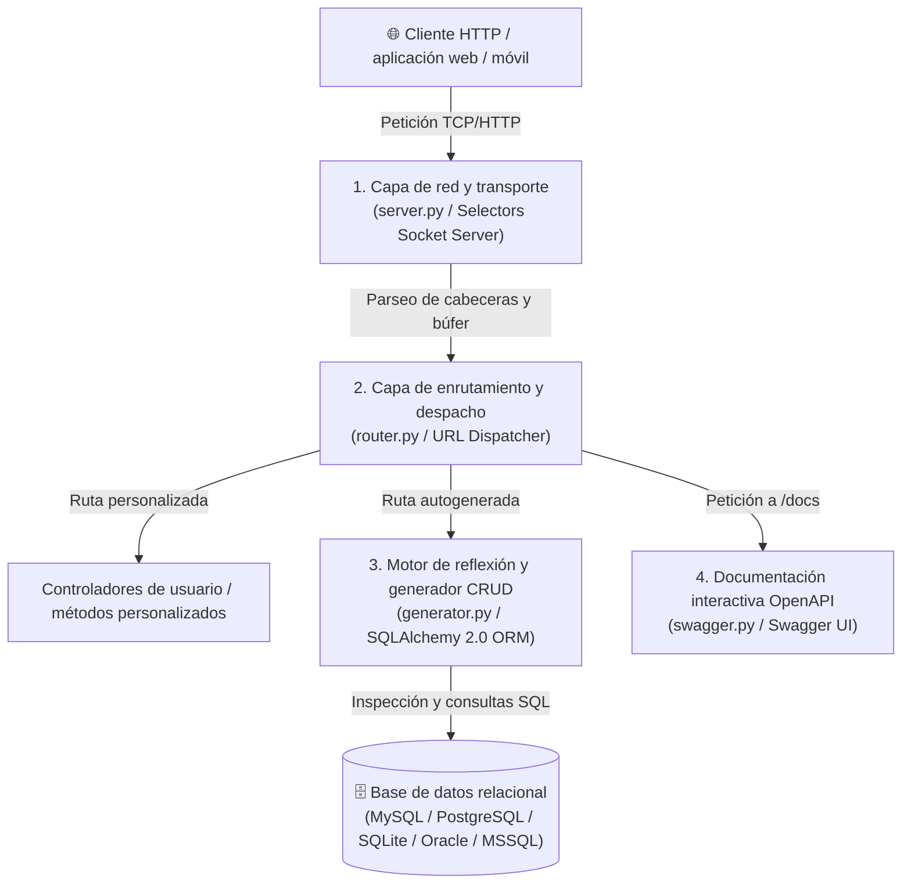

<div align="center">

# ⚡ APY (Asynchronous Python API Framework)
### Micro-framework web asíncrono de alto rendimiento para la generación automatizada de APIs RESTful en Python

[](https://www.python.org/)
[](LICENSE)
[](https://www.sqlalchemy.org/)
[](https://swagger.io/)
[](https://fim.uas.edu.mx/)

<p align="center">
  <b>APY</b> es un micro-framework web de ultra-bajo consumo de recursos y alta concurrencia diseñado para desacoplar a las APIs RESTful de las capas pesadas tradicionales de WSGI/ASGI. Implementa un servidor HTTP nativo basado en <b>sockets TCP no bloqueantes</b> y <b>selectores I/O multiplexados</b>, incorporando un <b>motor de reflexión relacional</b> capaz de inspeccionar bases de datos completas y generar endpoints CRUD listos para producción con documentación interactiva Swagger en segundos.
</p>

[Características principales](#-características-principales) •
[Arquitectura del sistema](#-arquitectura-del-sistema) •
[Benchmarks de rendimiento](#-benchmarks-de-rendimiento) •
[Entorno de pruebas y servidores](#-entorno-de-pruebas-y-especificaciones-de-los-servidores) •
[Instalación y despliegue rápido](#-instalación-y-despliegue-rápido) •
[Guía de uso](#-guía-de-uso) •
[Equipo de investigación](#-equipo-de-investigación-y-colaboradores) •
[Licencia](#-licencia)

</div>

---

## 🚀 Características principales

* **Servidor HTTP nativo con sockets asíncronos:** comunicación directa a nivel de transporte (`socket.socket` y `selectors.DefaultSelector`) para despachar miles de solicitudes concurrentes sin sobrecarga de capas intermedias.
* **Generador automático de CRUD por reflexión:** inspecciona automáticamente esquemas de bases de datos relacionales vía SQLAlchemy 2.0 y genera endpoints completos (`GET`, `GET by ID`, `POST`, `PUT`, `DELETE`, `PATCH`) en tiempo de ejecución.
* **Compatibilidad multi-SGBD:** soporte integrado para MySQL, MariaDB, PostgreSQL, SQLite, Oracle y Microsoft SQL Server.
* **Documentación interactiva Swagger / OpenAPI 3.0:** generación dinámica de la interfaz Swagger UI en `/docs`, permitiendo la inspección y prueba directa de todos los endpoints generados.
* **Enrutador modular extensible:** soporte para decoradores `@routes.get()`, `@routes.post()`, `@routes.put()`, `@routes.delete()`, `@routes.patch()` con procesamiento automático de query params, encabezados y cuerpo en JSON.
* **Soporte CORS y seguridad:** manejo configurable de encabezados de intercambio de recursos de origen cruzado (CORS) y solicitudes previas (`OPTIONS`).

---

## 🏛️ Arquitectura del sistema

El framework opera bajo un diseño modular desacoplado estructurado en cuatro capas cardinales:



---

## 📊 Benchmarks de rendimiento

Durante las evaluaciones experimentales de estrés con la herramienta **Grafana K6**, **APY** demostró una latencia significativamente inferior frente a los frameworks líderes del ecosistema Python:

### Prueba remota en la nube (100 usuarios virtuales concurrentes durante 1 hora)

| Framework | Peticiones exitosas | Tiempo promedio de respuesta | Ventaja de rendimiento de APY |
|---|:---:|:---:|:---:|
| **⚡ APY Micro-Framework** | **100%** | **61.35 ms** | **Framework de referencia** |
| **Flask** | 100% | 72.96 ms | **APY es 15.91% más rápido** |
| **FastAPI** | 100% | 170.35 ms | **APY es 64.00% más rápido** |

### Pruebas locales detalladas por método HTTP (tiempo de respuesta en ms)

| Método HTTP | Sujeto de prueba | Tiempo de referencia | Tiempo APY | Porcentaje de mejora |
|:---:|:---:|:---:|:---:|:---:|
| **GET** | FastAPI<br>Flask | 2.20 ms<br>1.79 ms | **1.22 ms**<br>**1.22 ms** | **44.5%**<br>**31.8%** |
| **POST** | FastAPI<br>Flask | 1.76 ms<br>1.81 ms | **1.17 ms**<br>**1.17 ms** | **33.5%**<br>**35.4%** |
| **PUT** | FastAPI<br>Flask | 2.17 ms<br>1.69 ms | **1.18 ms**<br>**1.18 ms** | **45.6%**<br>**30.2%** |
| **DELETE** | FastAPI<br>Flask | 2.08 ms<br>1.81 ms | **1.17 ms**<br>**1.17 ms** | **43.8%**<br>**35.4%** |
| **PATCH** | FastAPI<br>Flask | 2.07 ms<br>1.70 ms | **1.14 ms**<br>**1.14 ms** | **44.9%**<br>**32.9%** |

---

## 🖥️ Entorno de pruebas y especificaciones de los servidores

Para garantizar la reproducibilidad y el rigor científico de las mediciones de rendimiento, se utilizaron dos entornos de hardware independientes:

### 1. Servidor remoto en la nube (ambiente de producción simulado)
* **Proveedor de infraestructura:** Oracle Cloud Infrastructure (OCI).
* **Procesador (CPU):** 4 OCPUs Ampere Altra A1 (arquitectura ARM64 a 3.0 GHz).
* **Memoria RAM:** 24 GB DDR4 a 3200 MHz.
* **Almacenamiento:** 200 GB SSD NVMe.
* **Ancho de banda de red:** 10 Mbps simétricos.
* **Sistema operativo:** Ubuntu Server 20.04 LTS (kernel Linux de 64 bits).
* **Puertos de ejecución:** Puerto 4201 para APY y puerto 4202 para el framework de referencia.

### 2. Máquina de pruebas local (generación de carga y evaluación de rendimiento bruto)
* **Procesador (CPU):** Intel Xeon E-2176M (6 núcleos físicos, 12 hilos a 2.70 GHz base / 4.40 GHz turbo).
* **Memoria RAM:** 32 GB DDR4 a 2666 MHz.
* **Almacenamiento:** 512 GB SSD NVMe M.2.
* **Ancho de banda de red:** 100 Mbps.
* **Sistema operativo:** Windows 11 Pro (versión de 64 bits).

### 3. Configuración de la prueba de carga sintética (Grafana K6)
* **Métricas evaluadas:** tiempo de respuesta en milisegundos (`http_req_duration`), peticiones por segundo y tasa de fallos.
* **Perfil de tráfico:** 100 usuarios virtuales simultáneos con envío continuo de solicitudes durante 1 hora por cada método HTTP evaluado.
* **Tasa de errores obtenida:** 0% de errores en todas las iteraciones ejecutadas sobre APY.

---

## 💻 Instalación y despliegue rápido

### Requisitos previos
* **Python 3.11** o superior instalado en el sistema.
* Gestor de paquetes `pip` y soporte de entornos virtuales `venv`.
* (Opcional) Servidor de base de datos MySQL, PostgreSQL o SQLite local o remoto.

### 1. Clonar el repositorio
```bash
git clone https://github.com/tesisDrHerman/MicroFrameworkAPY.git
cd MicroFrameworkAPY
```

### 2. Crear y activar entorno virtual
En Windows:
```powershell
python -m venv venv
.\venv\Scripts\activate
```

En Linux / macOS:
```bash
python3 -m venv venv
source venv/bin/activate
```

### 3. Instalar dependencias
```bash
pip install -r requirements.txt
```

### 4. Iniciar el servidor de prueba
```bash
python main.py
```
El servidor quedará a la escucha en `http://127.0.0.1:4201`.  
Podrás acceder a la documentación interactiva Swagger directamente en:
👉 **`http://127.0.0.1:4201/docs`**

---

## 📖 Guía de uso

### Ejemplo 1: enrutamiento manual de endpoints
Puedes definir tus propias rutas y controladores de forma limpia y desacoplada:

```python
from server import Server, Router, Http_status

# Inicializar servidor y enrutador
api = Server(HOST="127.0.0.1", PORT=4201, SHOW_URLS=True)
router = Router()
status = Http_status()

@router.get("/api/v1/saludo")
def obtener_saludo(request):
    return {
        "status": status.HTTP_200_OK,
        "body": {
            "mensaje": "¡Bienvenido a APY Micro-Framework!",
            "concurrencia": "Sockets no bloqueantes"
        }
    }

@router.post("/api/v1/usuarios")
def crear_usuario(request):
    datos = request.body
    return {
        "status": status.HTTP_201_CREATED,
        "body": {
            "resultado": "Usuario registrado exitosamente",
            "datos_recibidos": datos
        }
    }

api.router.add_router(router)
api.run()
```

### Ejemplo 2: generación automática de CRUD desde base de datos
Para generar automáticamente las rutas de todas las tablas de una base de datos existente:

```python
from server import Server
from generator import Database, Generator

api = Server(HOST="0.0.0.0", PORT=5000)

# 1. Configurar conexión a la base de datos
db = Database(
    host="localhost",
    port=3306,
    database="mi_sistema",
    username="root",
    password="password_seguro",
    db_type="mysql"
)

# 2. Generar automáticamente todas las rutas CRUD
gen = Generator()
rutas_crud = gen.build_all(
    database=db,
    prefix="api",
    ask_for_tables=False,
    ask_for_methods=False
)

# 3. Montar rutas en el servidor
api.router.add_router(rutas_crud)
api.run()
```

Al iniciar, APY creará inmediatamente endpoints listos para consumir:
* `GET /api/{tabla}/` - Listado paginado de registros.
* `GET /api/{tabla}/{id}` - Consulta de registro individual.
* `POST /api/{tabla}/` - Creación de nuevo registro con validación de tipos.
* `PUT /api/{tabla}/{id}` - Actualización de campos.
* `DELETE /api/{tabla}/{id}` - Eliminación física.

---

## 👥 Equipo de investigación y colaboradores

Este proyecto es el resultado del trabajo de investigación y desarrollo científico gestado en el seno de la Licenciatura en Ingeniería de Software de la Facultad de Ingeniería Mochis (FIM), perteneciente a la Universidad Autónoma de Sinaloa (UAS):

| Colaborador | Rol en el proyecto | Afiliación institucional |
|---|---|---|
| **Dr. Herman Geovany Ayala Zúñiga** | Director / asesor de investigación y representante común | Universidad Autónoma de Sinaloa (FIM) |
| **Ing. Jesús Emmanuel Hernández Sinsel** | Desarrollador principal y autor sustentante | Universidad Autónoma de Sinaloa (FIM) |
| **Dr. Juan Francisco Figueroa Pérez** | Profesor investigador / coautor | Universidad Autónoma de Sinaloa (FIM) |
| **Dra. Rocío Jacqueline Becerra Urquídez** | Profesora investigadora / coautora | Universidad Autónoma de Sinaloa (FIM) |
| **Dr. Yobani Martínez Ramírez** | Profesor investigador / codirector de tesis | Universidad Autónoma de Sinaloa (FIM) |

---

## 📜 Vinculación académica

* **Tesis de grado:** *"Micro-Framework Web para la creación de APIs RESTFUL de alto rendimiento en Python"*, sustentada por el **Ing. Jesús Emmanuel Hernández Sinsel** bajo la dirección del **Dr. Herman Geovany Ayala Zúñiga** y la codirección del **Dr. Yobani Martínez Ramírez**.
* **Dictamen académico:** Aprobado por la Comisión de Titulación de la Facultad de Ingeniería Mochis el **28 de mayo de 2025**.

---

## 📄 Licencia

Este proyecto se distribuye bajo los términos de la **Licencia MIT**. Consulta el archivo [LICENSE](LICENSE) para mayores detalles sobre permisos de uso, distribución y modificación en entornos académicos y comerciales.
