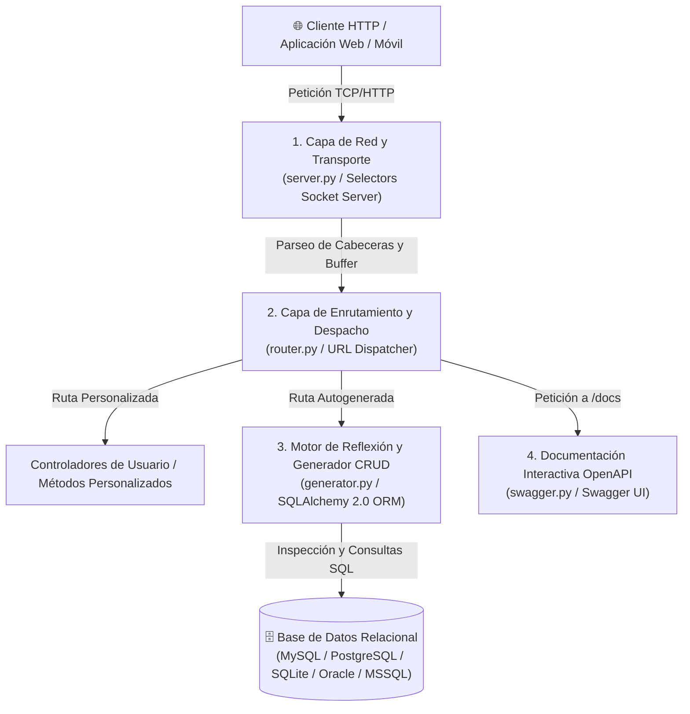

<div align="center">

# ⚡ APY (Asynchronous Python API Framework)
### Micro-Framework Web Asíncrono de Alto Rendimiento para la Generación Automatizada de APIs RESTful en Python

[](https://www.python.org/)
[](LICENSE)
[](https://www.sqlalchemy.org/)
[](https://swagger.io/)
[](https://www.indautor.gob.mx/)
[](https://fim.uas.edu.mx/)

<p align="center">
  <b>APY</b> es un micro-framework web de ultra-bajo consumo de recursos y alta concurrencia diseñado para desacoplar a las APIs RESTful de las capas pesadas tradicionales de WSGI/ASGI. Implementa un servidor HTTP nativo basado en <b>sockets TCP no bloqueantes</b> y <b>selectores I/O multiplexados</b>, incorporando un <b>motor de reflexión relacional</b> capaz de inspeccionar bases de datos completas y generar endpoints CRUD listos para producción con documentación interactiva Swagger en segundos.
</p>

[Características](#-características-principales) •
[Arquitectura](#-arquitectura-del-sistema) •
[Benchmarks](#-benchmarks-de-rendimiento) •
[Instalación](#-instalación-y-despliegue-rápido) •
[Guía de Uso](#-guía-de-uso) •
[Colaboradores](#-equipo-de-investigación-y-colaboradores) •
[Licencia](#-licencia)

</div>

---

## 🚀 Características Principales

* **Servidor HTTP Nativo con Sockets Asíncronos:** Comunicación directa a nivel de transporte (`socket.socket` y `selectors.DefaultSelector`) para despachar miles de solicitudes concurrentes sin sobrecarga de capas intermedias.
* **Generador Automático de CRUD por Reflexión:** Inspecciona automáticamente esquemas de bases de datos relacionales vía SQLAlchemy 2.0 y genera endpoints completos (`GET`, `GET by ID`, `POST`, `PUT`, `DELETE`) en tiempo de ejecución.
* **Compatibilidad Multi-SGBD:** Soporte integrado para MySQL, MariaDB, PostgreSQL, SQLite, Oracle y Microsoft SQL Server.
* **Documentación Interactiva Swagger / OpenAPI 3.0:** Generación dinámica de la interfaz Swagger UI en `/docs`, permitiendo la inspección y prueba directa de todos los endpoints generados.
* **Enrutador Modular Extensible:** Soporte para decoradores `@routes.get()`, `@routes.post()`, `@routes.put()`, `@routes.delete()` con parsing automático de query params, headers y body JSON.
* **Soporte CORS y Seguridad:** Manejo configurable de encabezados de intercambio de recursos de origen cruzado (CORS) y pre-flight requests (`OPTIONS`).

---

## 🏛️ Arquitectura del Sistema

El framework opera bajo un diseño modular desacoplado estructurado en cuatro capas cardinales:



---

## 📊 Benchmarks de Rendimiento

Durante las pruebas de estrés bajo la herramienta industrial **K6** ejecutadas en infraestructura cloud (Oracle Cloud Infrastructure - Ubuntu Server), **APY** demostró una latencia significativamente inferior frente a los frameworks líderes del ecosistema Python:

| Framework | Peticiones Exitosas | Tiempo Promedio de Respuesta | Ventaja de Rendimiento |
|---|:---:|:---:|:---:|
| **⚡ APY Micro-Framework** | **100%** | **61.35 ms** | **Framework de Referencia** |
| **Flask** | 100% | 72.96 ms | **APY es 15.91% más rápido** |
| **FastAPI** | 100% | 170.43 ms | **APY es 64.00% más rápido** |

> *Datos extraídos de la experimentación formal con 50 usuarios virtuales concurrentes bajo carga sostenida y conexión directa a base de datos relacional.*

---

## 💻 Instalación y Despliegue Rápido

### Requisitos Previos
* **Python 3.11** o superior instalado en el sistema.
* Gestor de paquetes `pip` y soporte de entornos virtuales `venv`.
* (Opcional) Servidor de base de datos MySQL, PostgreSQL o SQLite local o remoto.

### 1. Clonar el Repositorio
```bash
git clone https://github.com/tesisDrHerman/MicroFrameworkAPY.git
cd MicroFrameworkAPY
```

### 2. Crear y Activar Entorno Virtual
En Windows:
```powershell
python -m venv venv
.\venv\Scripts\activate
```

En Linux / macOS:
```bash
python3 -m venv venv
source venv/bin/activate
```

### 3. Instalar Dependencias
```bash
pip install -r requirements.txt
```

### 4. Iniciar el Servidor de Prueba
```bash
python main.py
```
El servidor quedará a la escucha en `http://127.0.0.1:4201`.  
Podrás acceder a la documentación interactiva Swagger directamente en:
👉 **`http://127.0.0.1:4201/docs`**

---

## 📖 Guía de Uso

### Ejemplo 1: Enrutamiento Manual de Endpoints
Puedes definir tus propias rutas y controladores de forma limpia y desacoplada:

```python
from server import Server, Router, Http_status

# Inicializar servidor y enrutador
api = Server(HOST="127.0.0.1", PORT=4201, SHOW_URLS=True)
router = Router()
status = Http_status()

@router.get("/api/v1/saludo")
def obtener_saludo(request):
    return {
        "status": status.HTTP_200_OK,
        "body": {
            "mensaje": "¡Bienvenido a APY Micro-Framework!",
            "concurrencia": "Sockets no bloqueantes"
        }
    }

@router.post("/api/v1/usuarios")
def crear_usuario(request):
    datos = request.body
    return {
        "status": status.HTTP_201_CREATED,
        "body": {
            "resultado": "Usuario registrado exitosamente",
            "datos_recibidos": datos
        }
    }

api.router.add_router(router)
api.run()
```

### Ejemplo 2: Generación Automática de CRUD desde Base de Datos
Para generar automáticamente las rutas de todas las tablas de una base de datos existente:

```python
from server import Server
from generator import Database, Generator

api = Server(HOST="0.0.0.0", PORT=5000)

# 1. Configurar conexión a la base de datos
db = Database(
    host="localhost",
    port=3306,
    database="mi_sistema",
    username="root",
    password="password_seguro",
    db_type="mysql"
)

# 2. Generar automáticamente todas las rutas CRUD
gen = Generator()
rutas_crud = gen.build_all(
    database=db,
    prefix="api",
    ask_for_tables=False,
    ask_for_methods=False
)

# 3. Montar rutas en el servidor
api.router.add_router(rutas_crud)
api.run()
```

Al iniciar, APY creará inmediatamente endpoints listos para consumir:
* `GET /api/{tabla}/` - Listado paginado de registros.
* `GET /api/{tabla}/{id}` - Consulta de registro individual.
* `POST /api/{tabla}/` - Creación de nuevo registro con validación de tipos.
* `PUT /api/{tabla}/{id}` - Actualización de campos.
* `DELETE /api/{tabla}/{id}` - Eliminación física.

---

## 👥 Equipo de Investigación y Colaboradores

Este proyecto es el resultado del trabajo de investigación y desarrollo científico gestado en el seno de la **Licenciatura en Ingeniería de Software** de la **Facultad de Ingeniería Mochis (FIM)**, perteneciente a la **Universidad Autónoma de Sinaloa (UAS)**, formalizado ante el **Instituto Nacional del Derecho de Autor (INDAUTOR)** en México:

| Colaborador | Grado Académico | Rol en el Proyecto | Participación | Afiliación Institucional |
|---|:---:|---|:---:|:---:|
| **Dr. Herman Geovany Ayala Zúñiga** | Doctor (Dr.) | Director / Asesor de Investigación y Representante Común | **40%** | Universidad Autónoma de Sinaloa (FIM) |
| **Ing. Jesús Emmanuel Hernández Sinsel** | Ingeniero (Ing.) | Desarrollador Principal y Autor Sustentante | **30%** | Universidad Autónoma de Sinaloa (FIM) |
| **Dr. Juan Francisco Figueroa Pérez** | Doctor (Dr.) | Profesor Investigador / Coautor | **10%** | Universidad Autónoma de Sinaloa (FIM) |
| **Dra. Rocío Jacqueline Becerra Urquídez** | Doctora (Dra.) | Profesora Investigadora / Coautora | **10%** | Universidad Autónoma de Sinaloa (FIM) |
| **Dr. Yobani Martínez Ramírez** | Doctor (Dr.) | Profesor Investigador / Codirector de Tesis | **10%** | Universidad Autónoma de Sinaloa (FIM) |

---

## 📜 Vinculación Académica y Propiedad Intelectual

* **Tesis de Grado:** *"Micro-Framework Web para la creación de APIs RESTFUL de alto rendimiento en Python"*, sustentada por el **Ing. Jesús Emmanuel Hernández Sinsel** bajo la dirección del **Dr. Herman Geovany Ayala Zúñiga** y la codirección del **Dr. Yobani Martínez Ramírez**.
* **Dictamen Académico:** Aprobado por la Comisión de Titulación de la Facultad de Ingeniería Mochis el **28 de mayo de 2025**.
* **Registro de Obra:** En trámite formal ante la Dirección del Registro Público del Derecho de Autor (**INDAUTOR**), en la rama de **Programa de Computación** (Software) conforme al **Acuerdo DOF 5781649**.

---

## 📄 Licencia

Este proyecto se distribuye bajo los términos de la **Licencia MIT**. Consulta el archivo [LICENSE](LICENSE) para mayores detalles sobre permisos de uso, distribución y modificación en entornos académicos y comerciales.
